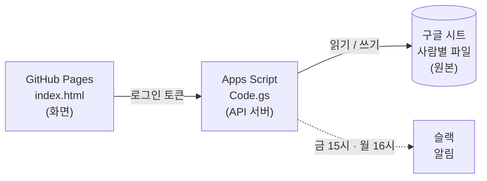

# PLAB 주간업무보고

사내 주간업무보고 작성·열람 화면입니다. 금요일에 작성하고, 월요일 17:30에 보고합니다.

## 구성



| 구성 | 역할 |
|---|---|
| **화면** `index.html` | 이 레포. 로그인한 사람은 본인 보고서를 작성하고, 모든 사람의 보고서를 열람합니다. |
| **서버** `Code.gs` | Apps Script. 구글 로그인 토큰을 검증한 뒤 시트를 읽고 씁니다. 편집은 로그인한 본인 파일에만 됩니다. |
| **원본** 구글 시트 | 공유 드라이브 `주간업무보고`의 사람별 파일, 주차별 탭. 시트에서 직접 고쳐도 웹에 그대로 읽힙니다. |
| **알림** 슬랙 | 금 15시 미제출 리마인드, 월 16시 요약(대표님 결정 필요·팀별 진행률). |

> ⚠️ `Code.gs`·`appsscript.json`은 이 레포에 올리지 마세요. 구성원 이메일·슬랙 ID·폴더 ID가 들어 있습니다. Apps Script 편집기에만 둡니다. (`.gitignore`에 등록되어 있음)
>
> `index.html`에 들어가는 Apps Script URL과 OAuth 클라이언트 ID는 공개돼도 되는 값입니다. 서버가 회사 계정 로그인을 확인하지 못하면 아무 데이터도 주지 않습니다.

## 한 주의 흐름


예) **10/23(금)** 에 작성하는 보고서 = 시트 탭 **`2026년 10월 4주차`**

| 칸 | 내용 |
|---|---|
| 지난주 과업 | 10/19 ~ 10/23 에 한 일 · 진행률 · 집행 금액 · 비고 |
| 이번주 과업 | 10/26 ~ 10/30 에 할 일 · 예상 비용 · 비고 |
| 대표님 결정 필요 | 승인·판단이 필요한 일과 금액 |

- 탭 이름은 **지난주 과업의 주** 기준입니다. (목요일이 속한 달로 몇째 주를 셈: 9/28~10/4 = 10월 1주차)
- **금요일부터** 웹을 열면 다음 보고서(위 예시에서는 4주차)가 기본으로 열리고, 다음 주 목요일까지 유지됩니다.
- 탭이 아직 없으면 웹의 **보고서 만들기** 버튼이 만들어 줍니다. 지난 보고서의 '이번주 과업'이 '지난주 과업'(진행률 0%)으로 넘어옵니다.

## 시트 칸 구조

데이터는 5행부터, 업무구분 하나가 여러 행(병합)을 차지할 수 있습니다. K열 이후(일일업무 자동 영역)는 웹이 건드리지 않습니다.

| 열 | B | C | D | E | F | G | H | I | J |
|---|---|---|---|---|---|---|---|---|---|
| 내용 | 업무구분 | 지난주 과업 | 진척률 | 비고 | 집행금액 | 이번주 과업 | 진척률 | 비고 | 예상비용 |

- 업무구분 이름이 `대표님 결정 필요`인 칸은 결정 사항으로 읽습니다.
- I2 칸에는 웹에서 저장한 시각이 기록됩니다.

### ■ 소제목

과업 칸 안에서 `■`로 시작하는 줄은 소제목입니다. 웹에서는 소제목만 보이고, 누르면 내용이 펼쳐집니다.

```text
■ 비품 구입 · 집행 ₩109,260
· 모니터 암 ₩25,620
· USB 5개 ₩49,750

■ 계약 관리 자동화 · 진행 60%
· 구독 관리 운영 중
```

- 소제목 줄 끝의 `· 진행 60%`, `· 집행 ₩금액`(이번주 칸은 `· 예상 ₩금액`)이 그 소제목의 진행률·금액입니다. 웹에서는 소제목마다 **+ 진행률 / + 금액** 버튼으로 넣고 뺍니다.
- 소제목에 값이 있으면 업무구분 전체 진행률은 **소제목 평균**, 금액은 **소제목 합계**로 자동 계산되어 D·F(H·J)열에 들어갑니다.
- 다음 주로 넘길 때 진행률은 0%로, 예상 금액은 지워집니다.

---

## 설치 순서

### 1. 로그인용 OAuth 클라이언트 ID 발급 (Google Cloud, 처음 한 번)
1. https://console.cloud.google.com → 상단 프로젝트 선택 → **새 프로젝트** (예: `plab-weekly`)
2. **API 및 서비스 → OAuth 동의 화면** → 사용자 유형 **내부** → 앱 이름 `PLAB 주간업무보고`, 지원 이메일 입력 → 저장
3. **API 및 서비스 → 사용자 인증 정보 → 사용자 인증 정보 만들기 → OAuth 클라이언트 ID**
   - 애플리케이션 유형: **웹 애플리케이션**
   - **승인된 JavaScript 원본**에 화면 주소의 도메인 부분만 추가
     - `https://<깃허브아이디>.github.io` (경로 `/plab-weekly/`는 넣지 않음)
     - 맞춤 도메인 `https://weekly.plab.life`
   - 리디렉션 URI는 비워 둠
4. 만들어진 **클라이언트 ID**(`….apps.googleusercontent.com`) 복사

### 2. Apps Script 서버 만들기
> 스크립트를 만들고 배포하는 계정이 **서버 계정**이 됩니다. 이 계정은 6명 시트 파일 모두에 **편집자** 권한이 있어야 합니다. 운영기획팀 계정을 권장합니다.

1. https://script.google.com → **새 프로젝트** → 이름 `PLAB 주간업무보고 API`
2. `Code.gs` 내용 전체를 붙여넣기 (CONFIG에 폴더 ID·이메일·슬랙 ID 확인. 시트 ID를 직접 넣을 때는 `fileId`에 **전체 ID**를 넣거나 `''`로 비워 폴더에서 찾게 함)
3. **프로젝트 설정(⚙)** → "appsscript.json 매니페스트 파일 표시" 체크 → `appsscript.json` 내용으로 교체 (Sheets API 고급 서비스 포함 — 빠른 읽기용)
4. 같은 화면 **스크립트 속성**에 추가

   | 속성 | 값 |
   |---|---|
   | `GOOGLE_CLIENT_ID` | 1단계에서 복사한 클라이언트 ID |
   | `SLACK_WEBHOOK_URL` | 알림 채널의 Incoming Webhook 주소 |
   | `WEBAPP_URL` | 화면 주소 `https://weekly.plab.life/` |

5. 함수 선택 → `checkSetup` 실행 (첫 실행 시 권한 승인) → 로그에서 6명 모두 파일·탭·업무구분이 나오는지 확인

### 3. Apps Script 배포
1. **배포 → 새 배포 → 유형 선택(⚙) → 웹 앱**
2. 실행 사용자: **나** / 액세스 권한: **모든 사용자**
   - GitHub Pages에서 호출하려면 "모든 사용자"여야 합니다. 대신 서버가 모든 요청의 구글 로그인 토큰을 검사해 `plabsolution.com` 계정만 통과시킵니다.
   - 선택지에 "모든 사용자"가 없으면 Workspace 관리 콘솔에서 Apps Script 웹앱 공유 제한이 걸린 것입니다. 관리자에게 허용을 요청하세요.
3. **웹 앱 URL**(`https://script.google.com/macros/s/…/exec`) 복사
4. 브라우저로 그 URL을 열어 `{"ok":true, ...}`가 보이면 정상

### 4. GitHub 레포·Pages
1. 레포에 아래 파일을 올립니다. 무료 플랜에서 Pages를 쓰려면 **Public** 이어야 합니다.

   | 파일 | 용도 |
   |---|---|
   | `index.html` | 화면 (로고·파비콘 포함) |
   | `manifest.webmanifest`, `sw.js`, `icons/` | 앱 설치(PWA) |
   | `CNAME` | 맞춤 도메인 `weekly.plab.life` |
   | `README.md`, `.gitignore` | 안내, 업로드 제외 목록 |

2. `index.html` 상단의 설정 채우기
   ```js
   window.PLAB_CONFIG = {
     APPS_SCRIPT_URL: "https://script.google.com/macros/s/…/exec",
     GOOGLE_CLIENT_ID: "….apps.googleusercontent.com",
     DOMAIN: "plabsolution.com"
   };
   ```
3. 레포 **Settings → Pages** → Source: **Deploy from a branch** → Branch: `main` / `/ (root)` → Save
4. 맞춤 도메인: Custom domain에 `weekly.plab.life`, DNS(가비아)에 `weekly` CNAME → `<깃허브아이디>.github.io`, **Enforce HTTPS** 체크

### 5. 슬랙 트리거
Apps Script 편집기에서 순서대로 실행
1. `testSlackWebhook` → 채널에 테스트 메시지 확인
2. `previewSlackMessages` → 금요일·월요일 메시지 문구를 로그로 확인 (전송 안 함)
3. `installTriggers` → 금 15시 미제출 리마인드, 월 16시 요약 등록 (끄려면 `removeTriggers`)
   - 구글 트리거는 지정한 시각부터 1시간 안에 실행됩니다. 월 16시로 두면 17:30 보고 전에 도착합니다.
   - 시각을 바꾸면 `installTriggers`를 다시 실행하세요.

### 6. 테스트
1. 화면 주소 접속 → "Google 계정으로 로그인" → 회사 계정 선택
2. 내 이름이 열리고, 탭이 없으면 **보고서 만들기** → 시트 맨 앞에 주차 탭 생성
3. 소제목·진행률·금액 입력 후 저장 → 시트 값 확인 → 사이드바 점이 초록(제출)으로
4. 다른 사람 이름 클릭 → 읽기 전용, **전체 현황**에서 KPI·팀별 진행률 확인
5. 개인 Gmail로 로그인 → 거절되는지 확인
6. 시트에서 직접 한 칸 고친 뒤 웹에서 새로고침 없이 저장 → 충돌 안내가 뜨면 정상

화면만 미리 보고 싶으면 주소 끝에 `?demo`를 붙이거나 `index.html`을 컴퓨터에서 바로 열면 샘플 데이터(가상 인물)로 동작합니다.

---

## 앱으로 설치 (PWA)

| 기기 | 방법 |
|---|---|
| PC 크롬·엣지 | 주소창 오른쪽 **앱 설치** 아이콘 |
| 안드로이드 크롬 | 메뉴(⋮) → **앱 설치** |
| 아이폰 사파리 | 공유 → **홈 화면에 추가** |

서비스 워커는 화면 틀과 아이콘만 저장합니다. 보고서 내용은 기기에 저장하지 않고 매번 로그인 후 받아옵니다.

## 수정·업데이트
- **화면 수정**: `index.html` 고쳐서 push → 1~2분 뒤 반영 (설치한 앱에도 자동 반영)
- **서버 수정**: Apps Script 편집기에서 고친 뒤 **배포 → 배포 관리 → ✏️ → 버전: 새 버전 → 배포**. 이렇게 하면 URL이 그대로 유지됩니다. "새 배포"를 만들면 URL이 바뀌니 주의하세요.
- **구성원 변경**: `Code.gs`의 `CONFIG.MEMBERS` 수정 후 새 버전 배포

## 알아둘 점
- 로그인은 1시간마다 갱신되며, 보통 자동으로 다시 로그인됩니다. 저장하지 않은 입력은 다시 로그인해도 화면에 남아 있습니다.
- 웹에서는 서버 계정 권한으로 시트를 읽고 쓰므로, 구성원 각자의 드라이브 권한과 무관하게 **열람은 전원, 편집은 본인만**입니다. 드라이브에서 시트를 직접 여는 것은 드라이브 권한을 따릅니다.
- 사이드바 제출 상태·전체 현황은 2분간 캐시됩니다. 시트에서 직접 고친 내용은 최대 2분 뒤 반영됩니다.
- 시트 칸 위치(B~J열, 5행부터)와 탭 이름 규칙을 바꾸면 웹이 잘못 읽습니다. 바꿔야 하면 `Code.gs`의 `CONFIG.LAYOUT`·`TAB_NAME`을 함께 고치세요.
