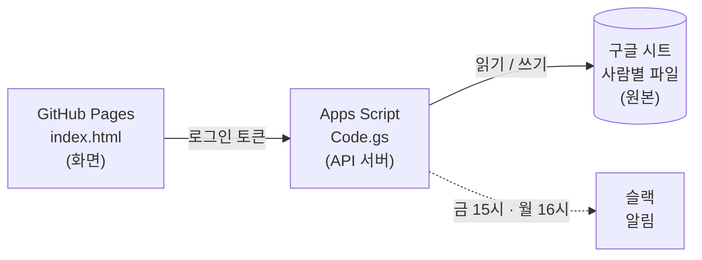
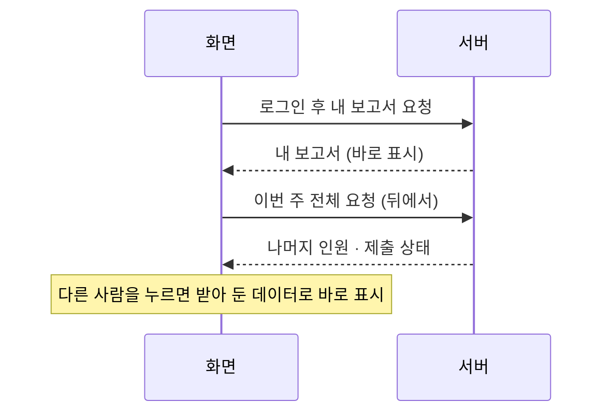

# PLAB 주간업무보고

PLAB 구성원이 주간업무보고를 작성하고, 서로의 보고서와 팀 전체 현황을 보는 사내 웹 화면입니다.
금요일에 작성하고 월요일 17:30에 보고하며, 작성한 내용은 각자의 구글 시트에 그대로 저장됩니다.

- 주소: https://weekly.plab.life
- 대상: `plabsolution.com` 회사 계정 (그 외 계정은 로그인 불가)

---

## 구성



| 구성 | 역할 |
|---|---|
| **화면** `index.html` | 이 레포. 보고서 작성·열람 화면, 사용법 안내, 앱 설치(PWA) |
| **서버** `Code.gs` | Apps Script. 구글 로그인을 확인한 뒤 시트를 읽고 씁니다. 편집은 로그인한 본인 파일에만 됩니다. |
| **원본** 구글 시트 | 공유 드라이브 `주간업무보고`의 사람별 파일, 주차별 탭 |
| **알림** 슬랙 | 금 15시 미제출 리마인드, 월 16시 요약 |

웹과 시트는 양방향입니다. 웹에서 저장하면 시트에 바로 들어가고, 시트에서 직접 고친 내용도 웹에 그대로 보입니다.

---

## 한 주의 흐름


예) **10/23(금)** 에 작성하는 보고서 = 시트 탭 **`2026년 10월 4주차`**

| 칸 | 내용 |
|---|---|
| 지난주 과업 | 10/19 ~ 10/23 에 한 일 · 진행률 · 집행 금액 · 비고 |
| 이번주 과업 | 10/26 ~ 10/30 에 할 일 · 예상 비용 · 비고 |
| 대표님 결정 필요 | 승인·판단이 필요한 일과 금액 |

- 탭 이름은 **지난주 과업의 주** 기준입니다. 몇째 주는 목요일이 속한 달로 셉니다. (9/28 ~ 10/4 = 10월 1주차)
- **금요일부터** 웹을 열면 다음 보고서가 기본으로 열리고, 다음 주 목요일까지 유지됩니다.
- 이번 주 탭이 없으면 **보고서 만들기** 버튼으로 만듭니다. 지난 보고서의 '이번주 과업'이 '지난주 과업'(진행률 0%)으로 넘어옵니다.

| 알림 | 내용 |
|---|---|
| 금 15시 | 아직 작성하지 않은 사람을 슬랙에서 멘션 |
| 월 16시 | 그날 보고할 보고서 요약: 제출 현황, 팀별 진행률·집행·예상 비용, 대표님 결정 필요 목록 |

---

## 화면 사용법

처음 로그인하면 화면 위에 **사용법 안내**가 한 번 뜹니다. 오른쪽 위 **?** 버튼으로 언제든 다시 볼 수 있습니다.

| 영역 | 설명 |
|---|---|
| 왼쪽 목록 | 팀별 구성원. 이름을 누르면 그 사람 보고서를 봅니다. 초록 점 = 제출, 빈 점 = 미작성 |
| 전체 현황 | 제출 현황, 팀별 평균 진행률, 이번 주 예상 비용 합계, 대표님 결정 필요 목록 |
| 주차 선택 | 위쪽 ‹ › 와 목록으로 지난 주차 보고서 열람 |
| 보고서 표 | 업무구분 · 지난주 과업 · 비고 · 이번주 과업 · 비고 · 대표님 결정 필요 |
| 저장 | 아래 **저장** 버튼 또는 `Ctrl` + `S` |

- **보기**는 모든 구성원의 보고서가 가능하고, **수정**은 내 보고서만 됩니다.
- 보고서를 작성하는 동안 시트에서 누가 같은 보고서를 고쳤다면, 저장할 때 덮어쓰지 않고 알려 줍니다. 새로 불러온 뒤 다시 저장하면 됩니다.
- 저장하지 않고 다른 화면으로 이동하면 확인 창이 뜹니다.

### ■ 소제목

과업 칸 안에서 `■`로 시작하는 줄은 소제목입니다. 화면에서는 소제목만 보이고, 누르면 내용이 펼쳐집니다.

```text
■ 비품 구입 · 집행 ₩109,260
· 모니터 암 ₩25,620
· USB 5개 ₩49,750

■ 계약 관리 자동화 · 진행 60%
· 구독 관리 운영 중
```

- **+ ■ 소제목 추가** 버튼을 누르거나, 줄 맨 앞에 `■`를 쓰면 소제목으로 묶입니다.
- **소제목 모두 펼치기** 버튼으로 한 번에 펼치거나 접을 수 있습니다.

### 진행률 · 금액

- 소제목마다 **+ 진행률**, **+ 집행금액**(이번주 칸은 **+ 예상금액**)을 켜서 넣을 수 있습니다. 필요 없는 소제목은 넣지 않아도 됩니다.
- 소제목에 값을 넣으면 업무구분 전체 진행률은 **소제목 평균**, 금액은 **소제목 합계**로 자동 계산됩니다.
- 소제목 금액은 종류를 고를 수 있습니다. 지난주 칸은 **집행 · 매출 · 계약**, 이번주 칸은 **예상 · 매출 · 계약**입니다.
  - **집행(예상)** 만 업무구분 합계와 시트 F(J)열, 전체 현황·슬랙 요약 금액에 들어갑니다.
  - **매출**(계산서 발행·입금)과 **계약**(수주 금액)은 따로 합산해 칸 아래와 표 머리에 `매출 ₩330만 · 계약 ₩900만`처럼 보여 줍니다.
  - 시트에는 제목 줄에 `■ 세금계산서 발행 · 진행 100% · 매출 ₩3,300,000`처럼 저장됩니다.
- 소제목을 쓰지 않는 칸은 칸 아래에서 진행률과 금액을 직접 넣습니다.
- 진행률 색: 100% 초록, 50 ~ 90% 파랑, 50% 미만 주황. 2주 이상 끝나지 않은 업무에는 **N주째** 표시가 붙습니다.
- 금액은 `30만`, `1.2억`, `300000`, `₩45만 5천` 모두 입력할 수 있습니다.
- 다음 보고서로 넘어갈 때 진행률은 0%로 바뀌고, 예상 금액은 지워집니다.

---

## 일일업무 (`daily.html`)

주간보고 화면 위쪽 **📝 일일업무** 버튼으로 이동합니다. 로그인은 주간보고와 같이 씁니다.

- 날짜를 고르고 **업무구분 · 한 일 · 상태(완료/진행/대기)** 를 한 줄씩 적습니다. 입력하면 자동 저장됩니다.
- `Enter` 다음 줄 · `Shift`+`Enter` 줄바꿈 · 빈 줄에서 `Backspace` 삭제 · 상태 칩을 누르면 완료 → 진행 → 대기 순으로 바뀝니다.
- **팀 전체**에서 그날 모든 구성원의 기록을 봅니다. 보기는 전원, 수정은 본인만 됩니다.
- **이번 주 모아보기 → 주간보고에 넣기**: 그 주(월~금) 기록을 업무구분별로 묶어 다음 주간보고의 '지난주 과업'에 ■ 소제목으로 넣습니다.
  - 진행률은 완료 100% · 진행 50% · 대기 0%로 채웁니다. 같은 일이 여러 날 있으면 마지막 날 상태를 씁니다.
  - 같은 업무구분 칸이 있으면 그 칸 끝에 붙이고, 없으면 새 행을 만듭니다. 이미 있는 소제목은 건너뛰므로 여러 번 눌러도 중복되지 않습니다.
  - 다음 주간보고 탭이 아직 없으면 주간보고 화면에서 먼저 **보고서 만들기**를 해야 합니다.

저장 위치는 사람별 파일의 **`일일업무` 탭 하나**입니다. 처음 저장할 때 자동으로 만들어지고, 날짜순으로 줄이 쌓입니다.

| 열 | A | B | C | D |
|---|---|---|---|---|
| 내용 | 날짜 | 업무구분 | 한 일 | 상태 (완료·진행·대기) |

- 시트에서 직접 고친 내용도 웹에 그대로 보입니다. 날짜 칸은 `2026-10-26`, `2026. 10. 26` 모두 읽습니다.
- 업무구분 목록은 가장 최근 주간보고 탭의 업무구분을 불러와 보여 주며, 새 이름을 직접 적어도 됩니다.

---

## 시트 칸 구조

웹은 아래 위치를 기준으로 시트를 읽고 씁니다. 데이터는 5행부터이고, 업무구분 하나가 여러 행(병합)을 차지할 수 있습니다.

| 열 | B | C | D | E | F | G | H | I | J |
|---|---|---|---|---|---|---|---|---|---|
| 내용 | 업무구분 | 지난주 과업 | 진척률 | 비고 | 집행금액 | 이번주 과업 | 진척률 | 비고 | 예상비용 |

- 업무구분 이름이 `대표님 결정 필요`인 칸은 결정 사항으로 읽습니다.
- 소제목의 진행률·금액은 과업 칸 안 제목 줄에 함께 저장되고, D·F(H·J)열에는 평균·합계가 들어갑니다.
- I2 칸에는 웹에서 저장한 시각이 기록됩니다.
- K열 이후(일일업무 자동 영역)는 웹이 건드리지 않습니다.
- 칸 위치나 탭 이름 규칙을 바꾸면 웹이 잘못 읽습니다. 바꿔야 할 때는 `Code.gs`의 `CONFIG.LAYOUT`·`TAB_NAME`도 함께 고쳐야 합니다.

---

## 불러오기 방식



- 로그인하면 **내 보고서를 먼저** 띄우고, 나머지 인원과 제출 상태는 뒤에서 받습니다.
- 주차를 바꿀 때도 보고 있던 사람의 보고서를 먼저 띄웁니다.
- 받아 둔 보고서와 제출 상태는 2분간 다시 쓰므로, 시트에서 직접 고친 내용은 최대 2분 뒤 웹에 반영됩니다. 새로고침하면 바로 받아옵니다.
- 작성 중인 화면은 뒤에서 데이터가 도착해도 다시 그리지 않습니다.

---

## 앱으로 쓰기 (PWA)

이 화면은 PC·휴대폰에 앱처럼 설치해서 쓸 수 있습니다. 설치한 앱에는 PLAB · Weekly Task 아이콘이 붙습니다.

- 앱은 화면 틀과 아이콘만 기기에 저장합니다. 보고서 내용은 저장하지 않고, 매번 로그인한 뒤 서버에서 받아옵니다.
- 화면을 고쳐 다시 올리면 설치한 앱에도 자동으로 반영됩니다.

---

## 파일 구성

| 파일 | 용도 |
|---|---|
| `index.html` | 주간보고 화면 (로고·파비콘·사용법 안내 포함) |
| `daily.html` | 일일업무 화면 |
| `manifest.webmanifest`, `sw.js`, `icons/` | 앱 설치(PWA) |
| `CNAME` | 맞춤 도메인 `weekly.plab.life` |
| `README.md` | 이 문서 |
| `.gitignore` | 레포에 올리지 않을 파일 목록 |

> ⚠️ `Code.gs`·`appsscript.json`은 이 레포에 올리지 않습니다. 구성원 이메일·슬랙 ID·폴더 ID가 들어 있어 Apps Script 편집기에만 둡니다.
>
> `index.html`에 들어가는 Apps Script URL과 OAuth 클라이언트 ID는 공개돼도 되는 값입니다. 서버가 회사 계정 로그인을 확인하지 못하면 아무 데이터도 주지 않습니다.

---

## 보안

- 회사 계정(`plabsolution.com`)으로 로그인해야 데이터를 받을 수 있습니다. 개인 Gmail은 거절됩니다.
- 서버가 모든 요청의 로그인 정보를 다시 확인하고, 편집은 로그인한 본인 파일에만 허용합니다.
- 시트에 수식으로 해석될 수 있는 글자(`=`, `+`, `-`, `@`로 시작)는 글자 그대로 저장합니다.
- 화면에 표시하는 글은 모두 특수문자를 처리해 스크립트가 실행되지 않게 합니다.
- 검색엔진에 노출되지 않도록 `noindex`가 설정되어 있습니다.
- 미리보기(`?demo`)의 샘플 데이터는 모두 가상 인물·가상 업무입니다.

---

## 알아둘 점

- 로그인은 1시간마다 갱신되며, 보통 자동으로 다시 로그인됩니다. 저장하지 않은 입력은 다시 로그인해도 화면에 남아 있습니다.
- 웹에서는 서버 계정 권한으로 시트를 읽고 쓰므로, 구성원 각자의 드라이브 권한과 무관하게 **열람은 전원, 편집은 본인만**입니다. 드라이브에서 시트를 직접 여는 것은 드라이브 권한을 따릅니다.
- 화면만 미리 보려면 주소 끝에 `?demo`를 붙이면 샘플 데이터로 동작합니다.
